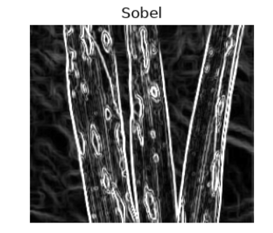
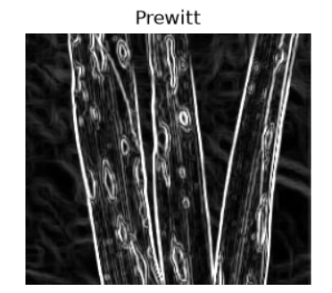
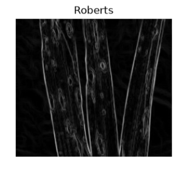
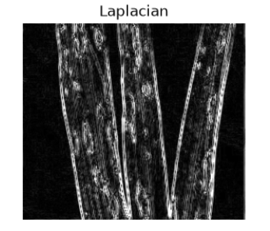
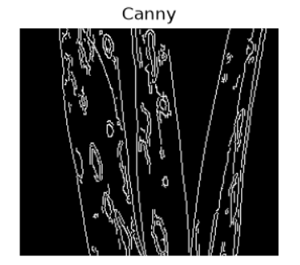

# edge-detection-opencv

## Aim

To perform edge detection using Sobel, Roberts, Prewitt, Laplacian, and Canny edge detectors.

---

## Software Required

- Anaconda – Python 3.7  
- Jupyter Notebook / VS Code  
- OpenCV (cv2)  
- NumPy  
- Matplotlib  

---

## ⚙️ Algorithm

### Step 1:
Import all the necessary modules for the program.

### Step 2:
Load an image using `cv2.imread()`.

### Step 3:
Convert the image to grayscale.

### Step 4:
Apply **Sobel operator** using OpenCV to detect edges.

### Step 5:
Apply **Prewitt operator** using custom kernels.

### Step 6:
Apply **Roberts operator** using custom kernels.

### Step 7:
Apply **Laplacian operator** using OpenCV.

### Step 8:
Apply **Canny edge detector** using OpenCV.

### Step 9:
Display all edge-detected images for comparison.

---

## Developed By

- **Name:**  Vikamuhan Reddy
- **Register No:** 212223240181

```py
import cv2
import numpy as np
import matplotlib.pyplot as plt

# Load image
img = cv2.imread("C:/Users/vikam/OneDrive/Desktop/pic1.jpg")

if img is None:
    raise FileNotFoundError("Image not found. Check the image path.")

# Convert to grayscale
gray = cv2.cvtColor(img, cv2.COLOR_BGR2GRAY)

# 1. Sobel Edge Detection
sobel_x = cv2.Sobel(gray, cv2.CV_64F, 1, 0, ksize=3)
sobel_y = cv2.Sobel(gray, cv2.CV_64F, 0, 1, ksize=3)
sobel = cv2.magnitude(sobel_x, sobel_y)
sobel = cv2.convertScaleAbs(sobel)

# 2. Prewitt Edge Detection
prewitt_x = np.array([[-1, 0, 1],
                      [-1, 0, 1],
                      [-1, 0, 1]], dtype=np.float32)

prewitt_y = np.array([[-1, -1, -1],
                      [ 0,  0,  0],
                      [ 1,  1,  1]], dtype=np.float32)

px = cv2.filter2D(gray, cv2.CV_32F, prewitt_x)
py = cv2.filter2D(gray, cv2.CV_32F, prewitt_y)
prewitt = cv2.magnitude(px, py)
prewitt = cv2.convertScaleAbs(prewitt)

# 3. Roberts Edge Detection
roberts_x = np.array([[1, 0],
                      [0, -1]], dtype=np.float32)

roberts_y = np.array([[0, 1],
                      [-1, 0]], dtype=np.float32)

rx = cv2.filter2D(gray, cv2.CV_32F, roberts_x)
ry = cv2.filter2D(gray, cv2.CV_32F, roberts_y)
roberts = cv2.magnitude(rx, ry)
roberts = cv2.convertScaleAbs(roberts)

# 4. Laplacian Edge Detection
laplacian = cv2.Laplacian(gray, cv2.CV_64F, ksize=3)
laplacian = cv2.convertScaleAbs(laplacian)

# 5. Canny Edge Detection
canny = cv2.Canny(gray, 100, 200)

# Display results
titles = ["Original Image", "Grayscale", "Sobel",
          "Prewitt", "Roberts", "Laplacian", "Canny"]

images = [cv2.cvtColor(img, cv2.COLOR_BGR2RGB), gray,
          sobel, prewitt, roberts, laplacian, canny]

plt.figure(figsize=(12, 8))

for i in range(len(images)):
    plt.subplot(3, 3, i + 1)
    plt.imshow(images[i], cmap="gray" if i != 0 else None)
    plt.title(titles[i])
    plt.axis("off")

plt.tight_layout()
plt.show()
```


## Output

###  Sobel Edge Detector


###  Prewitt Edge Detector
 

###  Roberts Edge Detector
 

###  Laplacian Edge Detector


###  Canny Edge Detector


---

## Result

Thus, edges are successfully detected using Sobel, Prewitt, Roberts, Laplacian, and Canny edge detection techniques. Each method highlights edges differently based on gradient and intensity variations, improving feature extraction and analysis.
